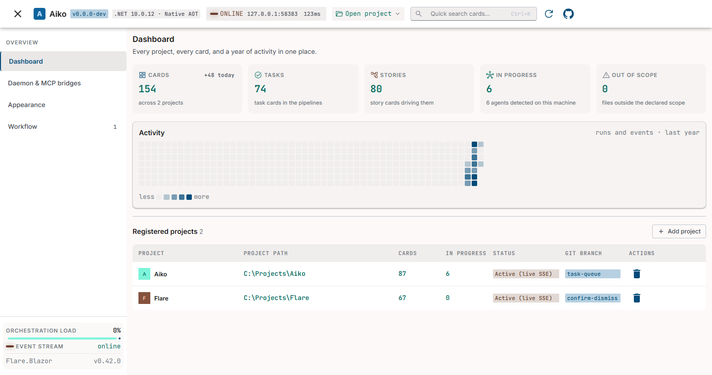
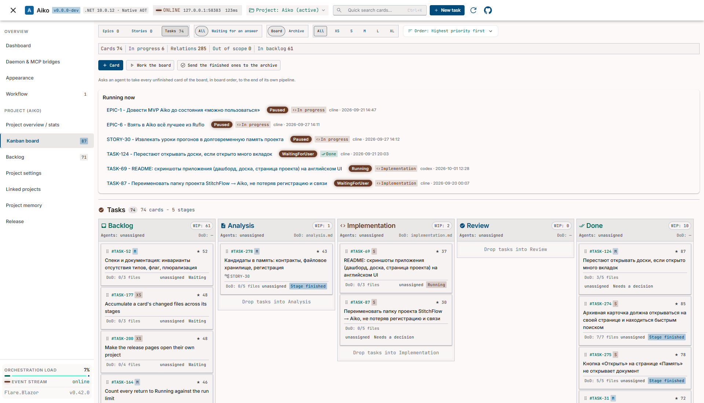
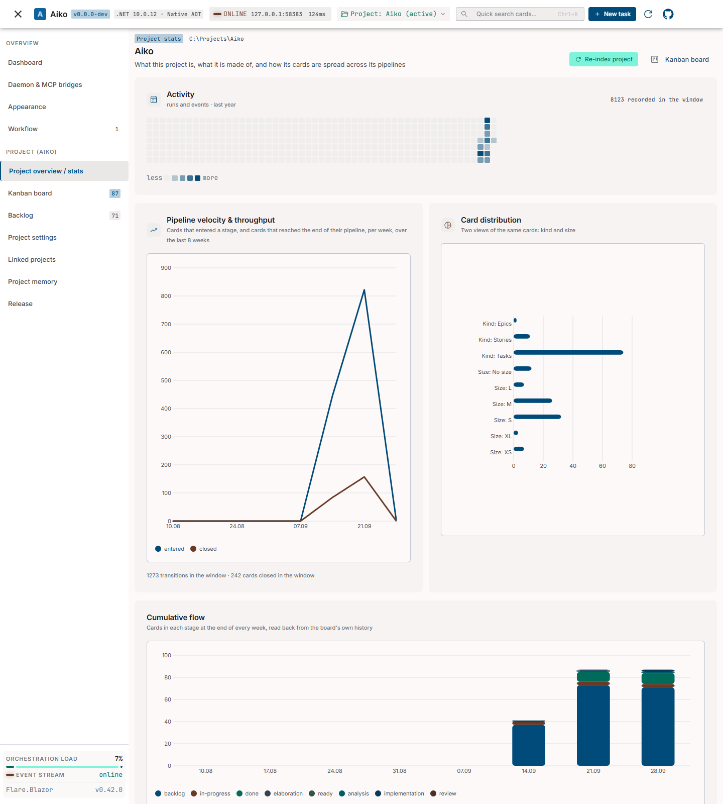
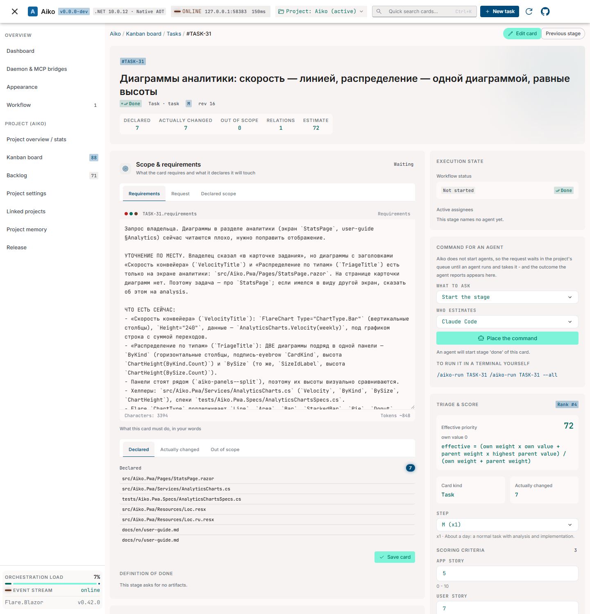
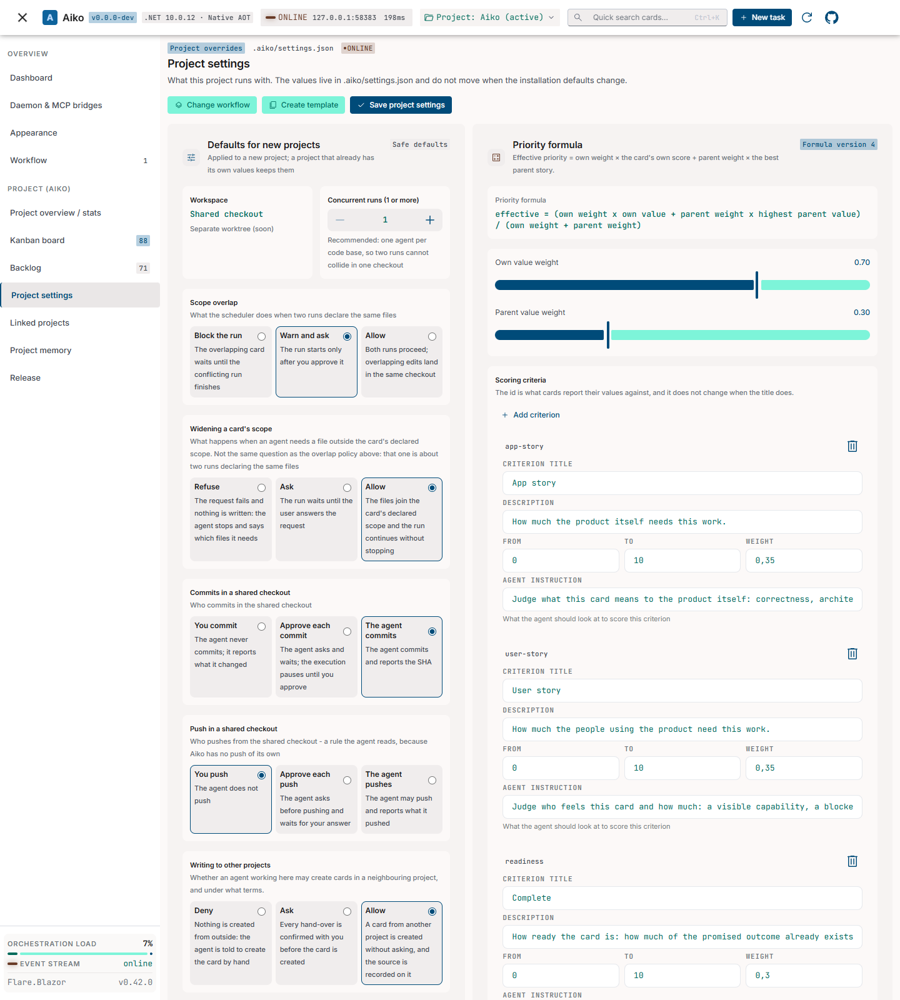

# Aiko - Screenshots

Captured from the Aiko project: dashboard and board at commit `20d2e19`; project overview, card and
project settings at `51e8340`. These development builds use the English interface and light
**Studio Modern** palette. Project paths are anonymized; card titles retain their original language.
Click an image to open it at full size.

## Dashboard

Projects, current work and activity across the workspace.

<table><tr><td></td></tr></table>

## Kanban board

The Aiko task pipeline, active runs and cards across stages.

<table><tr><td></td></tr></table>

## Project overview

Activity, pipeline velocity, card distribution and cumulative flow.

<table><tr><td></td></tr></table>

## Card page

Requirements, declared scope, execution status and scoring for a real Aiko task.

<table><tr><td></td></tr></table>

## Project settings

Workspace policies, priority formula and scoring criteria.

<table><tr><td></td></tr></table>

---

Back to the [README](../../README.md).
