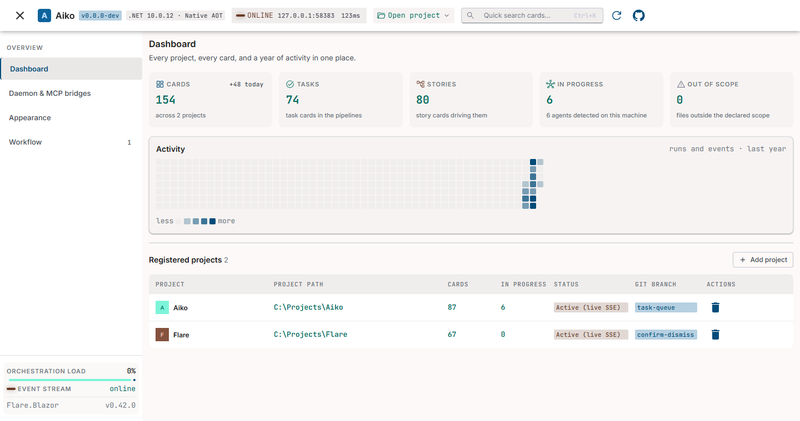
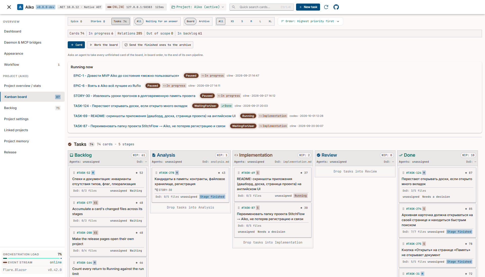
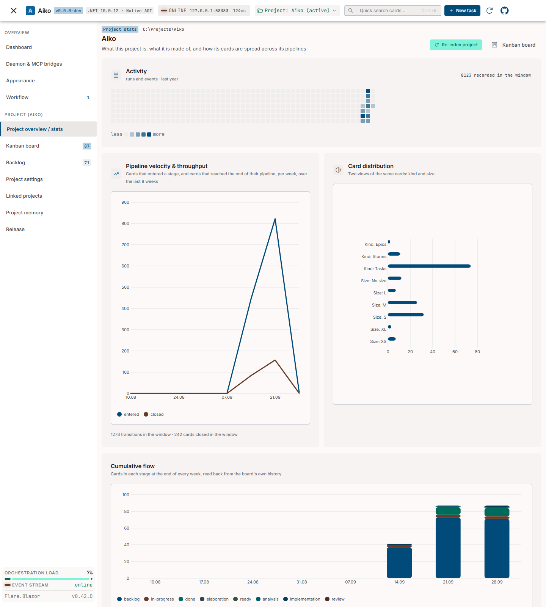
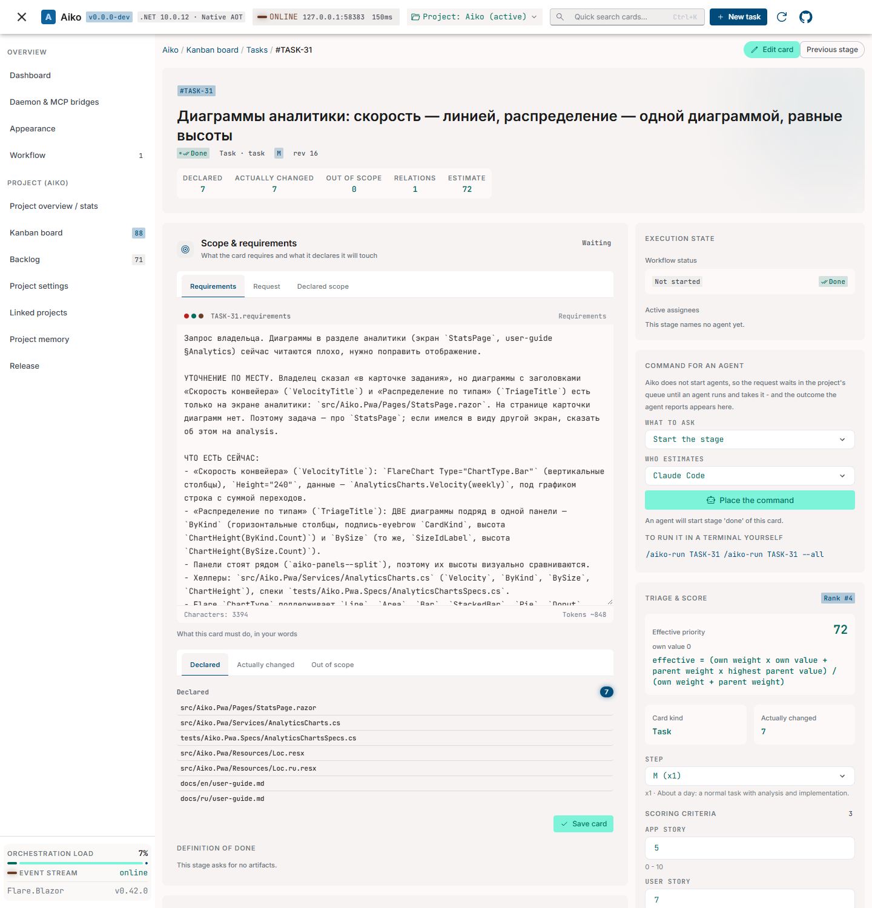
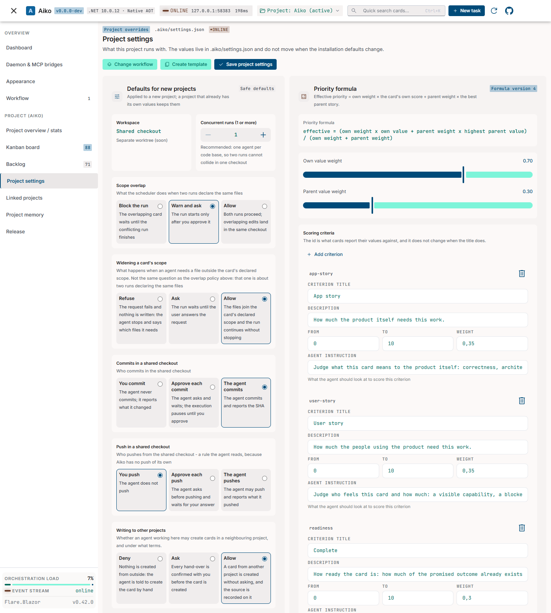

# Aiko - Скриншоты

Снято на проекте Aiko: дашборд и доска — с коммита `20d2e19`; обзор проекта, карточка и настройки
проекта — с `51e8340`. Сборки для разработки используют английский интерфейс и светлую палитру
**Studio Modern**. Пути проектов обезличены; названия карточек сохранены на исходном языке.
Нажмите на изображение, чтобы открыть его в полном размере.

## Дашборд

Проекты, текущая работа и активность всей рабочей области.

<table><tr><td></td></tr></table>

## Kanban-доска

Конвейер задач Aiko, активные запуски и карточки по этапам.

<table><tr><td></td></tr></table>

## Обзор проекта

Активность, скорость конвейера, распределение карточек и накопительный поток.

<table><tr><td></td></tr></table>

## Страница карточки

Требования, объявленная область файлов, состояние выполнения и оценка реальной задачи Aiko.

<table><tr><td></td></tr></table>

## Настройки проекта

Правила рабочей области, формула приоритета и критерии оценки.

<table><tr><td></td></tr></table>

---

Вернуться к [README](../../README.md).
